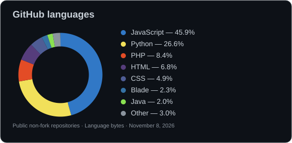

# Hi, I'm Adealix Jairon Maranan 👋

**BSIT student · Developer · Software QA · IoT enthusiast**

I'm a fourth-year Bachelor of Science in Information Technology student at **Technological University of the Philippines – Taguig**, with expected graduation in **August 2027**. I build web and mobile applications, plan software tests, and work on practical IoT and AI projects.

I'm exploring entry-level **technical support and service desk** opportunities, alongside customer service, software QA, and development roles. I'm available to start soon and open to onsite work.

## What I'm working on

### Artisam Labs — Lead Developer
**August 2026 – Present**

I primarily own implementation rather than manage other developers. My work spans Stellar applications, software QA, and technical media.

- **Firebreak:** Implementation of a Stellar incident-signal registry with dashboard and administrative tools. It shares incident signals so participating protocols can decide how to respond.
- **Kleym:** Implementation of a Stellar Testnet MVP that distributes rewards through individual claim links. It is undergoing internal validation, with Mainnet disabled and no external users onboarded yet.
- **[Lantern](https://github.com/kimerran/stellar-lantern):** QA engineer/software tester creating weekly test plans aligned with project deliverables; also producing promotional and tutorial media.
- **Team activities:** 321BuildersCamp and project presentations at Asia Pacific College and Block Quest Fiesta PH in Laguna. I also provide event photography and videography.

### Freelance system development
**December 2024 – April 2026**

Developed commissioned POS, booking, marketplace, gamification, and e-commerce applications using technologies including Laravel/PHP, React, React Native/Expo, JavaScript, MySQL, and MongoDB.

## Academic projects and practical work

- **Terminalia Catappa Seed-to-Oil:** Led AI application development using AutoML and the project's written documentation for seed-to-oil processing.
- **IoT and embedded systems:** Arduino, ESP32, Raspberry Pi, crayfish-incubator hardware, and greenhouse automation for sun shading, watering, and plant growing conditions.
- **Operating-system labs:** Windows installation, VirtualBox, file-server and RAID setup; networking fundamentals and RJ45 cabling.
- **MMDA “Bagong Gawi, Bagong Galaw Challenge”:** Participated in proposing smartphone applications for smarter travel and traffic management.

## Skills

| Area | Technologies and experience |
| --- | --- |
| Web and mobile | JavaScript, TypeScript, PHP, React, React Native, Expo, Node.js, Express, Laravel, jQuery, HTML, CSS |
| Programming and data | Python, C++, SQL, MySQL, PostgreSQL, MongoDB, AutoML |
| QA and tools | Weekly test planning, Postman, Insomnia, Git, GitHub, technical documentation |
| Systems and IoT | Windows, VirtualBox, networking fundamentals, Arduino, ESP32, Raspberry Pi |
| Media | Photography, videography, Blender animation, rotoscoping, Adobe Photoshop, tutorial production |

**Currently studying:** Mobile App Development using Java. My coursework also includes Operating Systems, Data Communication and Networking, Database Systems, Information Assurance and Security, IoT, and Software and Web Development.

## Completed training and badges

Completed through **Cisco Networking Academy**. These are course/module completion credentials and badges, not claims of passing separate professional certification exams. Listed with support-related learning first.

| Credential | Completed |
| --- | --- |
| [English for IT 1 — 50 hours](https://www.netacad.com/certificates/?issuanceId=88375be1-bb06-47b1-ba21-3dc908d362cd) | October 17, 2026 |
| [Networking Devices and Initial Configuration](https://www.netacad.com/certificates/?issuanceId=bcb1aeef-64b3-49f2-a2fb-036c29b5881a) | October 7, 2026 |
| [Introduction to Cybersecurity](https://www.netacad.com/certificates/?issuanceId=d91b7ef6-81cd-4712-b626-c5bb0b54a3ce) | October 6, 2026 |
| [Getting Started with Cisco Packet Tracer — module certificate](https://www.netacad.com/certificates/?issuanceId=063e6456-36c1-4342-a4e6-a5766ad986b2) | October 6, 2026 |
| [Python Essentials 2](https://www.netacad.com/certificates/?issuanceId=ae3b6127-f0f4-4763-be4c-511285c1e35b) | October 7, 2026 |
| [JavaScript Essentials 2](https://www.netacad.com/certificates/?issuanceId=90393f56-d9a4-42bc-be2f-7323c0edf540) | October 17, 2026 |
| [Python Essentials 1](https://www.netacad.com/certificates/?issuanceId=0342da07-aa33-4195-b33a-a3390f4a4d59) | October 6, 2026 |
| [JavaScript Essentials 1](https://www.netacad.com/certificates/?issuanceId=791a293a-cf13-4051-ad80-1f2023923267) | October 7, 2026 |
| [Introduction to IoT](https://www.netacad.com/certificates/?issuanceId=42c748a8-fa66-45de-b5e9-dc7cff341220) | October 6, 2026 |

## Volunteering

**Philippine Blockchain Week — June 2026:** Managed event paperwork and supported organisers with assigned administrative tasks. Received a participation certificate.

## Portfolios and contact

- [Development portfolio](https://adealix.netlify.app/)
- [Operating Systems portfolio](https://adealixmaranan123.wixsite.com/operating-systems)
- [Multimedia portfolio](https://adealixmaranan123.wixsite.com/adealix-projects)

### Connect with me

## GitHub languages

*Snapshot of public, non-fork repository language bytes as of November 8, 2026; excludes this profile repository. This chart is not a measure of proficiency.*
